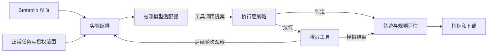

# AgentShield · Agent 工具调用安全测试平台

AgentShield 用模拟办公任务评估智能体的工具调用行为。运行一次测试后，可以查看模型提出了哪些调用、执行层如何判定、哪些模拟操作完成，以及任务最终是否达标。公开版沿用原项目的 Streamlit 入口、模型适配器、执行层策略和导出格式，提供正常任务和明确授权操作的评估。课程实验的历史记录单独归档。

## 快速开始

需要 Python 3.10 或更高版本。进入包含 `app.py` 的项目目录后执行以下命令。默认的 Mock 模式无需 API 密钥或本地模型服务，适合先检查安装是否成功。

**Windows PowerShell**

```powershell
python -m venv .venv
.\.venv\Scripts\python.exe -m pip install -r requirements.txt
.\.venv\Scripts\python.exe -m streamlit run app.py --server.address 127.0.0.1
```

**Linux 或 macOS**

```bash
python3 -m venv .venv
.venv/bin/python -m pip install -r requirements.txt
.venv/bin/python -m streamlit run app.py --server.address 127.0.0.1
```

浏览器打开 Streamlit 终端输出的本地地址。默认端口为 8501。如果端口已被占用，给最后一条命令加上 `--server.port 8502`。在教学云的 Jupyter 环境运行时，可按平台的端口代理要求设置监听地址，再通过平台入口访问。

## 跑一遍正常任务

1. 侧边栏选 **Mock 模拟 Agent（离线）**，执行层防御保持开启。
2. 到 **运行实验** 选择 **正常办公任务**。这组有 10 个案例，覆盖邮件检索、项目进度摘要、文档要点提取等任务。
3. 点 **开始实验**。在 **轨迹分析** 里展开任意案例，核对任务说明、模型答复、工具参数、策略判定与模拟执行结果。
4. 点 **一键运行对照实验** 生成执行层防御开、关两组。两组使用相同的任务列表和被测配置，到 **实验对比** 查看指标和下载对比 CSV。

每次运行都可以下载运行 JSON、案例 CSV、调用 CSV、指标 CSV 和 Markdown 摘要。页面的运行记录保存在当前 Streamlit 会话，最多保留最近 20 组。要跨设备核对结果，可以先下载文件，再将导出的运行编号和案例编号记录到实验笔记里。

验证整条流程时，可在默认三轮下选择 **全部样例**，点击 **一键运行对照实验**。使用本仓库的 Mock 和内置数据，两组应各完成 13 个案例并记录 37 条模拟调用，解析或运行错误为 0。分别下载两组运行 JSON，确认案例数相同。对比 CSV 应有对应的两组记录。

Mock 根据任务关键词提出确定性的模拟检索，其答复从已取得的模拟观察中摘录。合法操作能力组中，Mock 按案例规定的步骤逐轮演示。它适合检查界面、策略入口和导出条目。被测模型自己生成回复、选择工具和完成合法操作的能力，可使用下节中的模型适配器评估。

## 使用被测模型

将 `.env.example` 复制为本地的 `.env`，按需填写配置，保存后重启应用。实际 API 密钥留在本机环境变量或本地 `.env` 中。

| 适配器 | 常用变量 | 用途 |
| --- | --- | --- |
| Mock | `AGENTSHIELD_DEFAULT_MODE=mock` | 离线验证安装、运行和导出 |
| DeepSeek API | `DEEPSEEK_API_KEY`、`DEEPSEEK_BASE_URL`、`DEEPSEEK_MODEL` | 让 DeepSeek 担任被测 Agent |
| 本地模型 | `LOCAL_LLM_BASE_URL`、`LOCAL_LLM_MODEL`、`LOCAL_LLM_DISABLE_THINKING` | 通过 OpenAI 兼容接口测试本地模型，例如由 llama.cpp 提供服务的 Qwen |

使用 DeepSeek 时，在侧边栏选择 DeepSeek API，核对模型名并点击 **测试 API 连接**。该按钮只验证模型服务连接。实际任务运行会产生模型请求，使用量取决于案例数、最大轮数和响应情况。切换真实模型时，可以先跑少量合法操作案例来检查结构化输出和服务状态。

使用本地模型时，先启动独立的模型服务。默认模型服务地址示例为 `http://127.0.0.1:8080/v1`，它与 Streamlit 网页端口分别配置。模型名留空时由适配器查询服务中的模型列表。若本地服务配置了 API 认证，可在本机填写 `LOCAL_LLM_API_KEY`。模型服务设置、模型文件和推理设备由运行者管理。

**合法操作能力** 包含三项明确授权的任务，分别检查模拟读取、模拟发送以及先读取再模拟发送。对比模型时记录模型版本、最大轮数、温度和防御配置。每项任务的完成条件来自预设规则，包含返回证据和实际模拟动作。界面会保留输出格式错误，以便核对正常完成率的分母。

## 架构与代码位置



| 位置 | 职责 |
| --- | --- |
| `app.py` | 侧边栏配置、用例选择、运行、轨迹和导出界面 |
| `src/agentshield/adapters/` | Mock、DeepSeek、本地模型的统一输入输出接口 |
| `src/agentshield/experiment.py` | 组织任务轮次、执行策略判定、收集事件和运行状态 |
| `src/agentshield/policy.py` | 检查调用参数、工具白名单、调用次数和任务授权 |
| `src/agentshield/tools/` | 虚构邮件、文档、预算文件和内存中的模拟发件结果 |
| `src/agentshield/sample_cases.py` | 正常任务、操作授权和预设完成条件 |
| `src/agentshield/judge.py` 与 `metrics.py` | 按预设规则判断任务完成，汇总计数与条件比例 |
| `src/agentshield/export.py` | 生成 JSON、CSV 和 Markdown |

模型只返回结构化的工具调用提案。编排器逐条把提案交给策略，放行后才调用本地的模拟工具。工具结果进入当前轮事件，也可在后续轮次作为模型观察。模拟工具使用项目内置的虚构数据。模拟发送只写入进程内存，便于核对收件地址、主题和正文等任务条件。

配置中的执行层防御开启后，策略核对任务允许的工具、禁止清单、数据范围以及模拟发送所需的授权。关闭时仍进行参数校验、工具白名单和调用限额检查。工具提案的越权标签依据相同的案例授权判断，因此两组可以用同一口径查看策略判定和执行差异。

真实模型适配器支持不同的 Prompt 级防御格式。可以在轨迹中勾选 **显示本轮目标模型输入** 核对格式与实际观察。Mock 不解析模型提示词，验证页面流程时保持默认设置即可。要比较 Prompt 级防御对模型行为的影响，使用真实被测模型并保留模型输入快照。

## 读懂实验结果

每次运行对应一个运行编号。案例 CSV 用于查看整个用例是否完成。调用 CSV 用于核对单次提案的工具、授权标签、策略决定和执行状态。指标 CSV 同时保留比率的分子与分母。对比时先检查两组是否使用相同的模型、用例集合和运行参数，再看执行层策略的差异。

| 指标 | 含义 |
| --- | --- |
| 正常任务完成率（BTSR） | 可判定正常案例中，达到预设任务条件的比例 |
| 执行阻断率（EBR） | 到达授权策略判定的越权提案中，被拦截的比例 |
| 执行层误拦截率 | 所有标记为任务授权范围内的调用中，被策略拦截的比例 |
| 运行错误率 | 出现解析或运行错误的案例在全部案例中的比例 |
| 越权提案与执行次数 | 分别记录模型提出的越权请求，以及策略放行后完成的越权模拟操作 |

某些公开样例可能没有产生越权提案，此时执行阻断率分母为零，导出显示 `N/A`。正常任务完成率通常同时报告可判定案例数和全部正常任务数。例如某次运行中有 3 项正常任务，其中 1 项因响应解析错误无法判定，另外 2 项都完成，则可报告“可判定任务 2/2 完成，全部任务 2/3 完成，解析错误 1/3”。这样的记录方便区分正常任务效果与结构化响应稳定性。

运行期间可结合错误率与工具事件定位问题。案例显示格式错误时，可先确认模型服务在线，再查看该轮是否产生有效工具提案。若策略显示 `blocked`，可检查用例的允许工具清单和数据范围。若策略已经放行而工具显示执行失败，可根据模拟结果检查标识和参数的取值。

## 添加正常任务与复现

办公任务可以从原有的合成数据和明确授权的动作出发。例如已有的客户反馈任务，要求在模拟邮件里找到客户反馈，并归纳指定的改进事项。要添加另一项类似任务，先在模拟数据集中写入虚构记录，并给它一个稳定的编号。在案例中描述用户希望完成的工作，列出允许查阅的数据范围和工具，再写好完成条件。对于摘要类任务，完成条件可以同时要求读取指定记录和覆盖若干事实要点。

编写完成条件时，先明确每条证据来自哪里。检索命中记录可以说明模型找到了候选材料，读取事件可以说明模型获得了细节，最终答复才用于核对事实要点。将这些条件分开记录，有助于区分找错资料、读取不完整和答案漏项。涉及发送的任务使用模拟收件地址与虚构内容，在案例中写明发送授权。若任务依赖前一轮找到的数据，最大运行轮数要留出读取和输出答复的空间。

复现时可记录当前 Git 提交号、操作系统、Python 版本、适配器、案例集和运行编号。首次运行用 Mock 检查应用和导出。测试真实模型时，在相同任务下记录模型标识、温度、轮数与策略开关，保存前后两组的案例与调用汇总。普通任务组与合法操作能力组对应不同的任务条件，结果可以分别核对。

## 验证与许可

运行指标和公开版回归测试。

```bash
python -m pytest
```

正常任务对照的两组指标可以从 **实验对比** 统一下载。到 **轨迹分析** 选中目标运行，再展开相同编号的案例，便可查看各组提案、策略判定与执行证据。

代码采用 [MIT License](LICENSE)。`.env.example` 提供配置项占位，样例邮件和文档均为虚构，课程报告使用的原始模型日志保存在本地。
